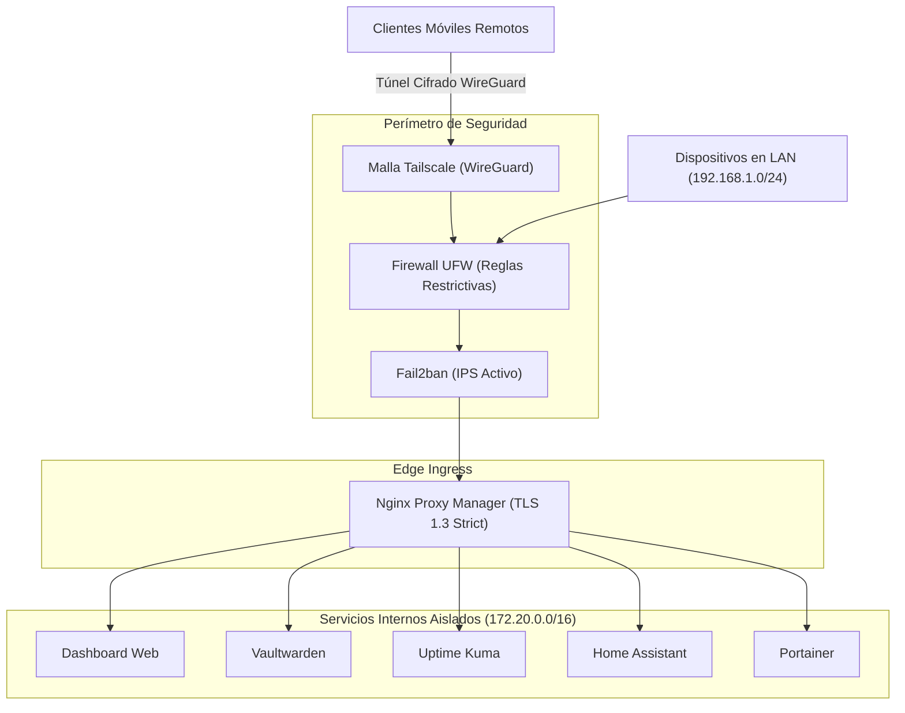

<div align="center">

# Personal Homelab Infrastructure (IaC & DevOps)

**Infraestructura como Código, Orquestación de Contenedores y Automatización en Servidor Linux 24/7**

[](https://www.docker.com/)
[](https://docs.docker.com/compose/)
[](https://ubuntu.com/)
[](https://nginxproxymanager.com/)
[](https://tailscale.com/)
[](LICENSE)

<br/>

> **Interfaz Visual**: Para explorar el panel de control web desarrollado a medida para monitorear y gestionar esta infraestructura en tiempo real, visita el repositorio complementario:  
> **[homelab-dashboard](https://github.com/santinohicke/homelab-dashboard)**

</div>

---

## Descripción General

Este repositorio contiene la arquitectura completa de **Infrastructure as Code (IaC)** para desplegar, operar y proteger un servidor personal hogareño (*Homelab*) de alta disponibilidad y bajo consumo energético.

El entorno está diseñado sobre principios de **Zero-Trust**, aislamiento mediante redes virtuales Docker, terminación TLS 1.3 con certificados Wildcard, filtrado DNS a nivel de red, gestión centralizada de contraseñas y automatizaciones programadas para copias de seguridad consistentes y auto-mantenimiento.

---

## Pila de Servicios en Ejecución

| Servicio | Contenedor | Puerto | Propósito & Descripción |
| :--- | :--- | :--- | :--- |
| **Nginx Proxy Manager** | `nginx-proxy-manager` | `:80`, `:443`, `:81` | Reverse proxy inverso, terminación SSL Wildcard, balanceo de carga y ruteo HTTP/S. |
| **Vaultwarden** | `vaultwarden` | `:8085` | Gestor de contraseñas Bitwarden autoalojado con cifrado end-to-end Zero-Knowledge (AES-256-GCM). |
| **Home Assistant** | `homeassistant` | `:8123` | Plataforma domótica residencial, sensores de telemetría e integraciones IoT locales. |
| **Uptime Kuma** | `uptime-kuma` | `:3001` | Monitoreo sintético de latencia ICMP/HTTP, tiempos de respuesta y cálculo de SLA 99.9%. |
| **Portainer CE** | `portainer` | `:9443` | Consola de administración visual de imágenes, volúmenes, redes y contenedores Docker. |
| **Fail2ban** | `fail2ban` | *Host Net* | Sistema de prevención de intrusiones (IPS); baneo automático de IPs atacantes por fuerza bruta. |
| **Pi-hole FTL** | *Host Engine* | `:53` | Motor de bloqueo DNS publicitario y resolución de dominios locales (*Split-Horizon*). |
| **Homelab Dashboard** | `homelab-dashboard` | `:3000` | Interfaz gráfica SPA React creada a medida para el control y telemetría de la infraestructura. |

---

## Arquitectura de Red & Seguridad



Para más detalles, consulta la documentación extendida en:
* **[Arquitectura de Red y Topología](docs/ARCHITECTURE.md)**
* **[Medidas de Fortalecimiento y Hardening](docs/SECURITY_HARDENING.md)**
* **[Ficha Técnica del Hardware](docs/HARDWARE.md)**

---

## Despliegue Rápido (Quick Start)

### 1. Requisitos Previos
* Servidor con **Ubuntu Server 22.04 LTS / 24.04 LTS** (o cualquier distro Linux compatible con Docker).
* **Docker Engine** (v24.x o superior) y **Docker Compose v2**.
* Conexión Ethernet con dirección IP estática en la red local.

### 2. Clonar el Repositorio
```bash
git clone https://github.com/santinohicke/homelab-infrastructure.git /opt/homelab
cd /opt/homelab
```

### 3. Configurar Variables de Entorno
Copia la plantilla de variables de entorno y ajusta los valores para tu entorno:
```bash
cp .env.example .env
nano .env
```

### 4. Iniciar la Pila de Servicios
```bash
# Crear la red virtual bridge si no existe
docker network create homelab-net --subnet 172.20.0.0/16

# Desplegar los contenedores en segundo plano
docker compose up -d
```

### 5. Verificar el Estado
```bash
./scripts/healthcheck.sh
```

---

## Política de Copias de Seguridad & Disaster Recovery

El sistema cuenta con una estrategia de respaldo 3-2-1 automatizada mediante scripts de Bash ejecutados diariamente a las 03:00 AM vía cron:

* **Consistencia de Bases de Datos**: Las bases SQLite (Vaultwarden, Home Assistant) se congelan mediante checkpoints `.backup` antes de comprimirse para evitar corrupción de datos en caliente.
* **Integridad Criptográfica**: Cada lote de copias genera un archivo `SHA256SUMS` para verificar que los archivos no hayan sufrido degradación de bits (*bit rot*).
* **Rotación Automática**: Retención estricta de **14 días** para optimizar el espacio en el SSD.
* **Script de Restauración Asistida**: En caso de pérdida total o corrupción, el script `./scripts/restore.sh <TIMESTAMP> <SERVICIO>` recupera cualquier servicio en menos de 5 minutos.

---

## Estructura del Repositorio

```text
homelab-infrastructure/
├── docker-compose.yml          # Declaración orquestada de todos los servicios
├── .env.example                # Plantilla de variables de entorno (sin secretos)
├── .gitignore                  # Exclusión estricta de llaves privadas, datos y logs
├── LICENSE                     # Licencia MIT
├── README.md                   # Documentación principal del repositorio
│
├── config/                     # Configuraciones de servicios
│   ├── nginx/
│   │   ├── dashboard.conf      # Servidor Nginx para la SPA React
│   │   └── nginx-proxy.conf.example # Template de Reverse Proxy y TLS 1.3
│   ├── fail2ban/
│   │   ├── jail.local.example  # Configuración de cárceles e intervalos de baneo
│   │   └── filter.d/npm-badbots.conf # Regex de detección de escáneres maliciosos
│   └── pihole/
│       └── custom.list.example # Mapeos DNS de subdominios locales
│
├── docs/                       # Documentación técnica en profundidad
│   ├── ARCHITECTURE.md         # Diagramas y topología de red
│   ├── HARDWARE.md             # Especificaciones del Lenovo ThinkCentre y consumo
│   └── SECURITY_HARDENING.md   # Hardening de SSH, UFW y certificados
│
└── scripts/                    # Automatizaciones de administración y mantenimiento
    ├── backup.sh               # Backup diario automatizado y cálculo SHA-256
    ├── healthcheck.sh          # Test de estado HTTP/TCP de contenedores
    ├── maintenance.sh          # Poda de Docker, limpieza de logs y apt hygiene
    └── restore.sh              # Asistente guiado de recuperación ante desastres
```

---

## Licencia

Este proyecto se distribuye bajo la Licencia **MIT**. Consulta el archivo [LICENSE](LICENSE) para más información.
