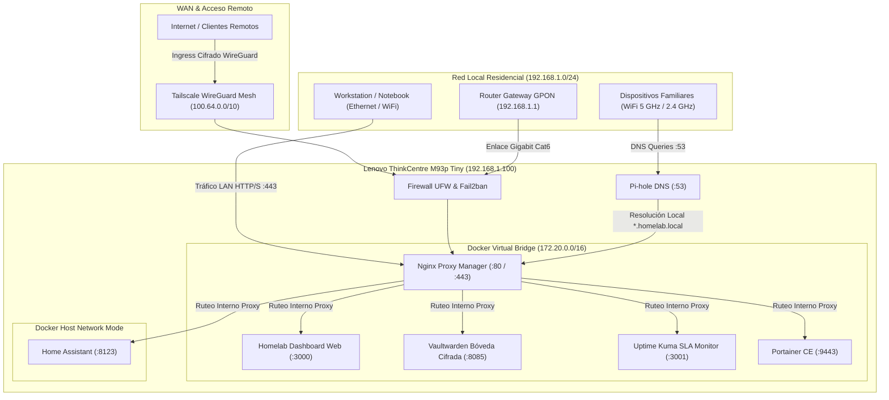

# Arquitectura de Red & Topología del Homelab

Este documento describe en profundidad el diseño de red, el flujo de paquetes de datos y el modelo de segmentación utilizado en el Homelab.

---

## 1. Diagrama de Flujo de Datos

---

## 2. Segmentación de Red

| Red / Subred | Tipo | Propósito | Rango de IPs |
| :--- | :--- | :--- | :--- |
| **LAN Primaria** | Física (Cat6 / 802.11ac) | Dispositivos del hogar y servidor físico | `192.168.1.0/24` |
| **Docker Bridge** | Virtual (Bridge) | Aislamiento entre contenedores de infraestructura | `172.20.0.0/16` |
| **Tailscale Mesh** | Overlay (WireGuard) | Conexión remota cifrada punto a punto sin abrir puertos WAN | `100.64.0.0/10` |

---

## 3. Resolución de Nombres (DNS Split-Horizon)
* **Localmente**: Pi-hole intercepta consultas DNS para `*.homelab.local` y responde directamente con la IP interna del servidor (`192.168.1.100`), evitando loopback routing innecesario en el router.
* **Remotamente**: Tailscale MagicDNS resuelve el nombre de host de la máquina (`homelab-node-01.tailscale.net`) dentro de la VPN WireGuard.
